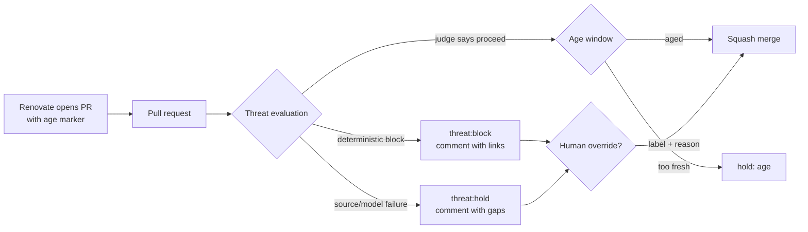

# Renovate threat evaluation

The age gate answers "has this release been out long enough". It cannot answer "is this release safe". This page describes the evidence layer that runs before the hold is evaluated, the two model roles, the verdict schema, and exactly where the gate will fail closed.

The operator's ruling was: "age is not sufficient, we also need tooling that checks for reported issues, cves, supply chain attacks, etc." The age wait is still useful. It is no longer sufficient on its own.

> [!IMPORTANT]
> The combined rule is **aged AND threat-checked proceed**. A pull request with no threat verdict, a stale verdict, a hold, a block, or an unreachable source does not merge. The only exception is an explicit human override, recorded on the pull request and in a JSONL audit log.

## The loop



The threat check runs **before** the age check. The ordering is deliberate: a deterministic block is cheap to establish and should stop the run before any wait is spent, and the merge rule reads as one conjunction in the report.

## Evidence sources and egress

Every source is read directly over HTTPS from the host that runs the gate. There is no proxy between the gate and these endpoints. Model calls are the exception: they go to `https://llmproxy.cove/v1`, where Cove nginx enforces the edge client token and injects the backend key.

| Source | Question it answers | Endpoint | Required | Egress path |
|---|---|---|---|---|
| OSV.dev | Does an advisory match this exact package and version? Is there a malicious-package (`MAL-*`) entry? | `POST https://api.osv.dev/v1/query` | yes | direct HTTPS |
| GitHub Security Advisories | Does a GitHub advisory list a range that covers the target? | `GET https://api.github.com/advisories?ecosystem=…&affects=…` | yes | direct HTTPS, optional `GITHUB_TOKEN` |
| NVD | Corroborating CVE description for a CVE alias returned by OSV | `GET https://services.nvd.nist.gov/rest/json/cves/2.0?cveId=…` | yes when OSV returns a CVE | direct HTTPS |
| PyPI JSON | Does the release exist? Is it yanked? What is the source repository? | `GET https://pypi.org/pypi/<pkg>/<version>/json` | for `pypi` | direct HTTPS |
| npm registry | Is the version deprecated? What is the source repository? | `GET https://registry.npmjs.org/<pkg>/<version>` | for `npm` | direct HTTPS |
| GitHub issue search | Open regression or bug reports that mention the target version | `GET https://api.github.com/search/issues?q=…` | when a GitHub repo resolves | direct HTTPS |
| Codeberg API | Open issues that mention the target version | `GET https://codeberg.org/api/v1/repos/<owner>/<repo>/issues` | when a Codeberg repo resolves | direct HTTPS |
| GitHub issue search (supply chain) | Reports of compromise, typosquats, account takeovers | `GET https://api.github.com/search/issues?q=…` | yes (default search provider) | direct HTTPS |
| HN Algolia | Tech-news discussion of a compromise | `GET https://hn.algolia.com/api/v1/search_by_date?query=…` | yes (default search provider) | direct HTTPS |
| Brave Search | General web search for compromise reports | `GET https://api.search.brave.com/res/v1/web/search` | optional | direct HTTPS, requires `COVE_THREAT_SEARCH_KEY` |
| llmproxy.cove | Query generation, evidence summarisation, verdict | `POST https://llmproxy.cove/v1/chat/completions` | yes | Cove nginx edge, shared client token |

### Reachability, measured 2026-10-31

The probe is `python3 scripts/renovate/threat_eval.py probe`. It performs one harmless request per source and prints a table. Both runs below used the same script and configuration.

From the workstation host that runs the bb automation:

```text
| Source | Reachable | Detail |
|---|---|---|
| OSV | yes | ok |
| GitHub advisories | yes | ok |
| NVD | yes | ok |
| PyPI | yes | ok |
| npm | yes | ok |
| GitHub issue search | yes | ok |
| Codeberg | yes | ok |
| HN Algolia | yes | ok |
| LLM proxy | yes | model text:light answered |
```

From a `python:3-alpine` container on the Docker default bridge, which exercises the same outbound egress path a Forgejo job container uses:

```text
| Source | Reachable | Detail |
|---|---|---|
| OSV | yes | ok |
| GitHub advisories | yes | ok |
| NVD | yes | ok |
| PyPI | yes | ok |
| npm | yes | ok |
| GitHub issue search | yes | ok |
| Codeberg | yes | ok |
| HN Algolia | yes | ok |
| LLM proxy | NO | no token in the container (expected; the proxy is reached from the automation host) |
```

The live `cove-forgejo-runner` container was not running on this machine at verification time, so the runner-specific run is the container row above. The runner adds no egress proxy: it uses the host's Docker network and outbound HTTPS. If the threat check is later moved into a runner job, run `probe` there before enabling it, and add the client token to that job.

> [!NOTE]
> GitHub's unauthenticated search allowance is 10 requests per minute and 60 core requests per hour. A full threat run makes roughly one advisory request, one issue request, and up to three search requests per package. Set `GITHUB_TOKEN` in the automation environment to move from the shared unauthenticated allowance to 5,000 requests per hour. Without it, a rate limit is a source failure and therefore a hold, never a proceed.

## What can and cannot be queried, per ecosystem

| Renovate datasource | OSV ecosystem | GitHub advisories | Registry metadata | Upstream issues | Structured verdict possible |
|---|---|---|---|---|---|
| `pypi` | `PyPI` | `pip` | PyPI JSON (yanked, repo) | GitHub via `project_urls` | yes |
| `npm` | `npm` | `npm` | npm registry (deprecated, repo) | GitHub via `repository` | yes |
| `cargo` | `crates.io` | `rust` | none wired | GitHub if metadata resolves | OSV and advisories only |
| `go` | `Go` | `go` | none wired | none wired | OSV and advisories only |
| `maven` | `Maven` | `maven` | none wired | none wired | OSV and advisories only |
| `nuget` | `NuGet` | `nuget` | none wired | none wired | OSV and advisories only |
| `packagist` | `Packagist` | `composer` | none wired | none wired | OSV and advisories only |
| `rubygems` | `RubyGems` | `rubygems` | none wired | none wired | OSV and advisories only |
| `github-actions` | `GitHub Actions` | `actions` | GitHub repo metadata | GitHub | yes |
| `hex`, `pub`, `swift` | mapped | mapped | none wired | none wired | OSV and advisories only |
| `docker` | **none** | **none** | **none** | **none** | **no structured check** |
| `ansible-galaxy` | **none** | **none** | **none** | **none** | **no structured check** |

Container images are the honest gap. OSV indexes source packages, not image tags, and Docker Hub publishes no advisory feed keyed by tag. The threat check records a `coverage` evidence row saying so. Image updates are already held by the path policy (`compose/` requires staging E2E, an SBOM delta, and the `.env` re-sync), so the missing structured check does not make an image mergeable. Image CVE scanning remains the Trivy/SBOM path in the stack-update runbook.

Ansible Galaxy collections have no OSV ecosystem and no advisory feed, so they get the same explicit coverage row.

## The search layer

Known malicious publishes and typosquats increasingly land in OSV as `MAL-*` entries, and the GitHub Advisory Database carries many of them. That is the cheap, structured half. It is not complete: maintainer account takeovers, compromised CI, and reports that have not been ingested into an advisory database need search.

The search layer is pluggable:

| Provider | Key needed | What it covers | Default |
|---|---|---|---|
| `github_issues` | optional `GITHUB_TOKEN` | Issues and pull requests that mention the package and a compromise term, bounded to the last 90 days | yes |
| `hn_algolia` | no | Tech-news discussion of a compromise, bounded to the last 90 days | yes |
| `brave` | `COVE_THREAT_SEARCH_KEY` | General web results | no |

General web search without a key is not available. DuckDuckGo, Mojeek, Brave's HTML page, and Startpage all return a bot challenge or a JavaScript shell from this network, so the script does not pretend to scrape them. If the operator wants general web coverage, create a Brave Search API key and add `brave` to `search_providers`. Until then the tool says which two providers it used.

The cheap model does two jobs, both bounded:

1. **Query generation.** It turns the package, version, ecosystem, and pull-request title into two or three short keyword queries. The prompt forbids `site:` operators and prose. The tool strips them anyway, caps each query at 120 characters, and keeps at most three.
2. **Evidence summarisation.** It receives only the search hits (title, URL, snippet) and must return `{"findings":[{"url","finding","relevance"}]}`. Any URL the tool did not supply is dropped. The finding is one line. There is no free-form speculation field.

Search hits are evidence, not a verdict. The judge sees them with their source and relevance.

## Model roles and budget

| Role | Tier | Model alias | Job | Output shape |
|---|---|---|---|---|
| Research | light | `text:light` | Generate queries, summarise search hits | strict JSON, URLs constrained to supplied hits |
| Judge | standard | `vision:standard` | Weigh all evidence into proceed, hold, or block | strict JSON, URLs constrained to supplied evidence |

Both roles call `https://llmproxy.cove/v1/chat/completions` with the shared edge client token. The token is read from `COVE_LLM_PROXY_CLIENT_KEY`, then `cove creds vault-get 'op://Private/Cove LLM Proxy Client Key/client_key'`. It is never printed, never placed in a marker, and never sent to a provider directly.

The budget is a **hard token cap**, enforced before and after every model call:

| Limit | Default | Meaning |
|---|---|---|
| `per_check_tokens` | 12,000 | One pull request, all packages |
| `per_run_tokens` | 60,000 | Every pull request in one automation run |
| `summarize_max_tokens` | 1,800 | Cap for each research call |
| `judge_max_tokens` | 1,600 | Cap for the verdict call |
| `search_results` | 5 | Hits per query |
| `search_window_days` | 90 | Recency bound for search and issue queries |
| `check_deadline_s` | 120 | Wall-clock deadline for one check |

Expected consumption is roughly 2,000 to 4,500 tokens per check: query generation is dominated by the light model's reasoning, and the judge sees a compact evidence list. The price table in `threat_eval.config.json` converts tokens to an estimated USD figure. Those prices are estimates for reporting, not a billing guarantee; the enforced limit is the token count the proxy returns in `usage`.

A call is refused when fewer than 32 tokens remain. A provider that returns more tokens than the reserve allowed is charged and the overage is a budget failure. Either way the verdict is `hold`, and the report names the budget.

## The verdict

The judge returns a strict object. The tool validates it before it can become a verdict:

```json
{
  "verdict": "hold",
  "confidence": 0.62,
  "evidence": [
    {
      "id": "osv:GHSA-mh6f-8j2x-4483",
      "source": "osv",
      "url": "https://osv.dev/vulnerability/GHSA-mh6f-8j2x-4483",
      "finding": "GHSA-mh6f-8j2x-4483 affects event-stream 3.3.6: malicious package (CRITICAL)",
      "relevance": "direct"
    }
  ],
  "model_used": "vision:standard",
  "cost": { "usd": 0.0023, "tokens": 3480 },
  "rationale": "One advisory covers the target version.",
  "errors": [],
  "checked_at": "2026-10-31T12:00:00+00:00",
  "head_sha": "abc123",
  "packages": ["npm/event-stream@3.3.6"]
}
```

Validation rejects, and converts to `hold`:

- a verdict outside `proceed`, `hold`, `block`;
- a confidence outside `[0, 1]`;
- a finding whose URL is not in the evidence the tool supplied;
- missing rationale or non-JSON output;
- a model or transport error.

### Deterministic floor

The model cannot lower the floor:

| Deterministic finding | Floor |
|---|---|
| OSV advisory matching the exact target version | `block` |
| OSV `MAL-*` malicious-package advisory | `block` |
| PyPI release yanked, or npm version deprecated | `block` |
| GitHub advisory range covers the target, or a range cannot be parsed | `hold` |
| Any required source failure, model failure, or budget exhaustion | `hold` |
| A required source failure alongside a deterministic block | `block` remains `block`, and the gap is listed |
| Nothing adverse, all sources healthy | `proceed` (the judge still decides) |

### On the pull request

The verdict is posted as a comment containing the evidence table, the rationale, the cost, the gaps, and a machine-readable marker:

```text
<!-- cove-threat-eval:v1 <base64 payload> -->
```

The marker is what the next run reuses. A fresh `proceed` is reused for 24 hours when the head SHA is unchanged; a `hold` is re-checked after 60 minutes; a `block` is reused for 24 hours. A new commit always forces a new check.

The label is one of `threat:proceed`, `threat:hold`, or `threat:block`. The publisher creates the labels if they do not exist and removes the other two from the pull request, leaving Renovate's own labels alone.

## Fail-closed matrix

| Condition | Result | Visible where |
|---|---|---|
| Threat config missing or invalid, live run | Hard failure, non-zero exit, no merge | `**Failures**` in the report, ntfy if configured |
| Threat config missing or invalid, dry run | Every otherwise-eligible PR holds with the config error | Report row and note |
| OSV, GitHub advisories, NVD, registry, issue tracker, or search unreachable | `hold` | Comment evidence and `### Gaps` |
| Model token or client token missing | `hold` | Comment `### Gaps` |
| Model timeout, non-JSON, unknown verdict, hallucinated URL | `hold` | Comment `### Gaps` |
| Token budget exceeded | `hold` | Comment `### Gaps`, report note |
| Lock file maintenance with no per-package marker | `hold` with "cannot name what changed" | Report row |
| Datasource with no OSV mapping (docker, ansible-galaxy) | `coverage` evidence; the judge decides, and the path policy still holds `compose/` | Comment evidence |
| Cached verdict older than its TTL | Re-evaluated | Report note |
| Verdict `proceed`, aged, green, not a draft | Merge | Report |
| Verdict `hold` or `block` with a valid human override | Merge, if every other gate passes | Override acknowledgement and audit row |

The gate never reads "no marker" as permission. The `decide()` function requires an explicit `threat_verdict`, and `None` means "the check did not run", which is a hold.

## The operator escape hatch

A human can override a threat verdict, and only a human can:

1. Add the label `threat-override` to the pull request.
2. Add a comment whose line begins with `cove-threat-override:` and gives a reason of at least 10 characters, for example:

   ```text
   cove-threat-override: the OSV entry is for a different release line; upstream issue 412 confirms.
   ```

The merge script reads both, posts an acknowledgement comment on the pull request, appends a JSONL row to `COVE_RENOVATE_AUDIT_LOG` (default `~/.local/state/cove/renovate-threat-overrides.jsonl`, mode `0600`), and then lets the threat gate pass. The row records the login, reason, verdict, head SHA, packages, and the evidence URLs.

The override clears **only** the threat gate. It does not clear the 24-hour hold, the path policy, the required check, or the draft state. Those remain independent.

## What this cannot see

Model-evaluated security verdicts are heuristics. They can miss a novel attack and they can over-block on noise. The design tries to make both failures cheap to audit:

- The evidence links are the primary artifact. A human can open every URL in the comment in seconds.
- A deterministic finding always outranks the model.
- A missing source is a hold, not a pass.
- The model's finding URLs must already be in the evidence list, so a fabricated link is rejected rather than displayed.

It still cannot see:

- **Container image contents.** OSV indexes source packages, not image tags. A vulnerable base layer or a malicious binary in an image is invisible to this check.
- **A compromise that is not yet reported anywhere.** A brand-new malicious publish with no OSV entry, no GitHub issue, and no news hit passes the search layer. The age wait is the remaining mitigation for that window.
- **Private or self-hosted trackers.** Only GitHub and Codeberg issue APIs are wired.
- **Registries without an advisory feed.** Docker Hub, Codeberg's package registry, ghcr, lscr, and Ansible Galaxy have no structured feed this tool can query.
- **Build reproducibility and provenance.** The check reads metadata and reports, not the produced artifact. An SBOM delta and signature verification are separate controls.
- **Maintainer intent.** A legitimate maintainer can publish a bad release; a takeover can look legitimate until someone reports it.
- **Everything behind an API rate limit.** Without `GITHUB_TOKEN`, GitHub may return 403 and the verdict is hold. That is the intended direction of failure, but it is a real operational limit.

## Operator setup

1. Confirm the proxy is up and the shared client token is cached:

   ```shell
   cove litellm status
   cove creds vault-get 'op://Private/Cove LLM Proxy Client Key/client_key' >/dev/null && echo token-cached
   ```

2. Put a GitHub token in the automation environment as `GITHUB_TOKEN` (optional, strongly recommended). It only needs public read access. Do not put it in the repository.

3. Run the probe from the automation host:

   ```shell
   python3 scripts/renovate/threat_eval.py probe
   ```

4. Run one manual check against a package already in the tree:

   ```shell
   python3 scripts/renovate/threat_eval.py check \
     --datasource pypi --package idna --version 3.16 --head-sha deadbeef
   ```

   The command prints the same comment the automation would post. Exit 0 means `proceed`; exit 1 means `hold` or `block`.

5. The merge automation needs the config file beside the script. `COVE_THREAT_EVAL_CONFIG` can point somewhere else. There is no "off" switch that lets a merge proceed without a verdict; remove the automation instead.

## Tests

`cli/tests/test_threat_eval.py` pins the contract with injected feeds and an injected model, so no test touches the network:

- one test per verdict class (`proceed`, `hold`, `block`);
- the deterministic floor overriding a model that says proceed;
- an unreachable source holding without calling the model;
- a model error, a non-JSON answer, and a hallucinated URL each holding;
- the per-check and per-run token caps;
- a timeout holding;
- the override requiring both label and reason, and the audit row;
- publishing the comment and label, and the dry-run no-op;
- the shipped configuration schema and this guide's invariants.

The age-gate tests add the combined rule: missing verdict holds, hold holds, block holds, proceed merges only after the 24-hour hold, and a threat proceed does not bypass it.

## Related

- [Renovate on Forgejo](renovate.md) for the age gate and the release flow
- [Stack update runbook](stack-update-guide.md) for image pins and the SBOM process
- [Digest pinning plan](../musings/digest-pinning-plan.md) for the `compose/` hold
