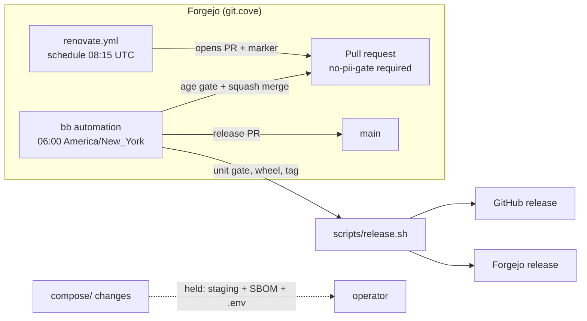

# Renovate on Forgejo, with an age-gated merge and republish

Two halves of one loop: Renovate proposes dependency pull requests against
Forgejo, and a scheduled bb automation decides which of them are old enough and
green enough to merge, then ships one coalesced release.

Both halves are **dry-run by default** and stay that way until the operator
turns them on. This page is the review artifact: the execution model, what
Renovate actually sees in this repo, the age numbers, the plan it produced, and
the exact operator action that enables it.

## The loop



## Execution model: the existing Forgejo runner

Renovate runs as a scheduled job in `.forgejo/workflows/renovate.yml` on
`cove-forgejo-runner`. That is the only place it can work rather than the
merely convenient one: the canonical remote is `git.cove`, the required check
and the branch protection live there, and the host is LAN-only, so a Renovate
pointed at `github.com` would open pull requests on the public mirror that
nobody merges and no gate covers. The runner already reaches the instance and
has the outbound egress Renovate needs for PyPI, Docker Hub, Codeberg,
`data.forgejo.org`, ghcr and lscr. The job image ships Node 24, so
`npx renovate` runs without a custom image or a docker socket. The version is
pinned (`RENOVATE_VERSION`) on purpose: Renovate decides which dependency
changes get proposed, so a silent major jump in Renovate itself is a
supply-chain decision, not a routine bump.

Three measured facts shaped the workflow:

| Measurement (2026-10-30) | Result | Consequence |
|---|---|---|
| `git.cove.local` from a job container on `cove_default` | resolves to `127.0.0.1` | the API's `clone_url` is unusable; `RENOVATE_GIT_URL=endpoint` clones over `http://forgejo:3000/...` instead |
| Actions token identity and powers | `forgejo-actions`; branch push `ok`; `POST /pulls` → `404 Can't read pulls or can't read UnitTypeCode` | the Actions token cannot run Renovate; the `RENOVATE_TOKEN` secret is required (see the operator action) |
| Runner job image toolchain | Node v24.22.1, npm 11.19.1, git 2.55.0 | no image install step, no docker socket |

The runner runs one job at a time (`capacity: 1`), so the 08:15 UTC Renovate
job can delay a pull-request check by a few minutes if they collide. That is
the price of one runner; it is noted rather than hidden.

## What Renovate sees

`renovate.json` extends `config:recommended`. The extraction below is from
`--platform=local --dry-run=full` on this checkout: 11 package files, 45
dependencies.

| Surface | Manager | Seen | Notes |
|---|---|---|---|
| `cli/pyproject.toml`, `cli/uv.lock` | `pep621` | yes, 10 deps | `uv.lock` maintenance is enabled (Mondays). Most runtime deps are lower-bound only, so the lock refresh is the real update channel. |
| `compose/docker-compose.yml` | `docker-compose` | yes, 10 deps | `${VAR:-image:tag}` is parsed and only the default inside the braces is rewritten. |
| `compose/tunnel.yml` | `docker-compose` | yes, after `managerFilePatterns` | the filename does not match Renovate's default compose pattern. |
| `compose/group_vars/all.yml` | custom regex | yes, forgejo tag + nginx image | group_vars is what the `.env` is rendered from and re-synced from on every converge, so a compose-only bump would not reach a fresh install or an existing host. |
| `compose/*/Dockerfile` `FROM` | `dockerfile` | yes, 18 deps | `apt`/`apk` installs are extracted then skipped (`unspecified-version`, `unknown-registry`). |
| `.forgejo/workflows/*.yml`, `.github/workflows/*.yml` | `github-actions` | yes, 6 deps | needs `GITHUB_COM_TOKEN` for github.com lookups; without it those updates are skipped with a warning. |
| `compose/requirements.yml` | `ansible-galaxy` | yes, 1 dep | `community.docker`. |
| `compose/litellm/docker-compose.yml`, `compose/docker-compose.staging.yml` | `docker-compose` | yes, 0 deps | every image is a bare `${VAR}`, so there is nothing to rewrite; the values live in the main compose file. |

`pinDigests: true` applies to the `FROM` lines, the action pins, and the compose
images that are not templated per-host. Two exceptions are deliberate:
`hashicorp/vault` is disabled entirely (tag and digest are two separate keys
and Renovate cannot derive the digest from the tag, so a tag-only bump would
leave a digest that no longer matches and the pull would fail), and
`forgejo`/`nginx` skip digest pinning until the digest-pinning plan collapses
each pin to one line.

### Known gaps, each with its manual path

Silence about a gap is how it becomes a surprise. These are not covered, and
each one has a named owner path:

| Gap | Why Renovate cannot do it | Manual path |
|---|---|---|
| `compose/bringup.yml` image defaults (`:812-852`) | a second copy of the same pins in the `.env` template | removed by `docs/musings/digest-pinning-plan.md` Phase 0 |
| `vault_image_tag` + `vault_image_digest` | two keys, digest not derivable | operator, runbook |
| `compose/litellm/Dockerfile` `litellm[proxy]==1.84.0` | pip pin inside a `RUN` line; the version also appears in the image tag and `.env` | operator, runbook |
| `compose/ade/Dockerfile` `ARG BB_APP_VERSION` | npm pin inside `RUN`; `cove ade update` already owns the pin | `cove ade update` |
| `compose/bifrost/Dockerfile` `dnsmasq=2.91-r1` | apk pin, extracted then skipped as `unknown-registry` | operator, Alpine release |
| `cli/cove/tunnel.py` per-arch zrok2 digests | a map, not a single reference | operator, with a test tying children to the declared index digest |
| `compose/toolhive/registry.json` OCI refs | three tags in JSON, not compose images | operator, digest-pinning Phase 4 |
| `compose/provision_forgejo.yml` job image | the label name *is* the contract; must stay floating | deliberate exception |
| `renovate.json` `RENOVATE_VERSION` | npm package in a `run:` line | hand bump |

### Labels are not created by Renovate

This repo has **zero labels**. Renovate's Forgejo platform looks labels up by
name and drops the ones it cannot find (`lookupLabelByName` returns `null`, no
create call), so `dependencies`, `security`, `minor` and `major` are inert until
they exist. Nothing in the merge automation depends on them: it classifies from
the PR-body marker and the `security` label only *shortens* a wait. Creating the
labels is an operator step, listed below.

## The age gate

The operator's words were "soon enough to protect zero-days, long enough to
avoid supply-chain attacks". That resolves to four classes:

| Class | Window | Clock starts at | Why |
|---|---|---|---|
| Security (`security` label, or `isVulnerabilityAlert`) | **48 h** | upstream release of the fixing version | A known CVE against a pinned version must not wait a week. 48 h still covers the window where a hijacked publisher pushes a malicious "fix" and it gets yanked. |
| Patch / pin / digest / lockfile maintenance | **7 d** | upstream release where known, else PR age | A week is long enough for a compromised release or a same-tag rebuild to be noticed and pulled; patch churn is the bulk of the volume, so one week keeps the PR board readable. |
| Minor | **14 d** | upstream release where known, else PR age | Behaviour changes inside a major line need more soak time than a patch, and they are rare enough that two weeks costs little. |
| Major | **never** | n/a | The digest-pinning plan and the stack-update runbook both require a gap analysis before a major bump. The automation reports it and stops. |

### Where the timestamp comes from, per ecosystem

Renovate resolves `releaseTimestamp` from whichever datasource it used, and the
configuration renders that value into the pull request body as a
machine-readable marker:

```
<!-- cove-age-gate:v1 datasource=… package=… version=… type=… released=… vulnerability=…; -->
```

The automation parses the marker and ages the **newest** upgrade in a group. A
group is only as old as its youngest member, so the newest wins.

The honest coverage of that signal, measured on this repo's dry run:

| Ecosystem | Release timestamp available | Source | Fallback |
|---|---|---|---|
| PyPI (`pypi`) | yes | upload time of the exact version | PR age |
| Docker Hub (`docker`) | sometimes (2 of 6 Docker Hub updates carried one: alpine) | tag push time | PR age |
| Codeberg, `data.forgejo.org`, ghcr, lscr (`docker`) | no (0 of 8) | not served | **PR age** |
| Ansible Galaxy | yes | collection publish time | PR age |
| github.com actions | only with `GITHUB_COM_TOKEN` | release/tag time | PR age |

That is why `minimumReleaseAgeBehaviour` is `timestamp-optional`: with the
default `timestamp-required`, every Codeberg, ghcr and lscr digest would be
"not stable" forever. Renovate therefore does not enforce a cooldown uniformly;
the merge automation's PR-age fallback is the signal that actually covers those
registries. The trade is stated plainly: for a registry that publishes no
timestamp, a PR opened today for a month-old release waits the full window, and
a PR opened today for a release from yesterday waits the same window. Both
directions are safe; neither is precise.

### How an update acquires the security label

Renovate's platform-level `vulnerabilityAlerts` reads Dependabot alerts and is
GitHub-only, so it cannot be the source here. `osvVulnerabilityAlerts: true` is
the source that does work on Forgejo: Renovate queries the OSV database offline
for direct `pypi`/`npm`/`cargo`/… dependencies and emits an update with
`isVulnerabilityAlert: true`. The `vulnerabilityAlerts` block is applied to those
updates (Renovate forces `packageFileConfig.vulnerabilityAlerts` onto every OSV
upgrade in `lib/workers/repository/process/vulnerabilities.ts`), which is how
the `security` label and the 48 h window reach them.

OSV does not scan container images. For an image rebuild that fixes a CVE the
label is applied by the operator, after the Trivy/SBOM signal in
`docs/musings/digest-pinning-plan.md`. That is the documented exception, not an
assumption.

## The merge automation

`scripts/renovate/age_gated_merge.py`, registered as a bb **script** automation.

Script mode, not agent mode: the run is deterministic (list, classify, merge,
release) and the skill's own rule is to use `script` when the output is fully
determined by code. An agent would add judgment where the operator asked for a
gate.

| Property | Value |
|---|---|
| Automation id | `auto_nmp9tuczxyu` (project `proj_7k2wuv6nbq`) |
| Schedule | `0 6 * * *` America/New_York, after the 08:15 UTC Renovate run |
| Working directory | `project` → `~/Documents/code/cove` on the bb server host |
| Timeout | 900 s (unit gate ≈ 70 s; merges and release are minutes) |
| Stored script | a snapshot under `~/.bb/plugins/automations/scripts/auto_nmp9tuczxyu/`; re-run `bb automation update` after editing the source |
| Exit codes | `0` completed (including "nothing eligible"); non-zero on auth, API, check, merge or release failure |
| Dry run | default. `COVE_RENOVATE_LIVE=1` in the automation env enables writes |

Per run it:

1. Resolves a Forgejo token (`FORGEJO_TOKEN`, else `cove creds vault-get
   forgejo-token`), and fails loud naming both when neither exists.
2. Lists open pull requests and keeps the ones whose head branch starts with
   `renovate/` or whose body carries the marker. Author name is not trusted;
   a fork cannot fake the branch prefix in this repo, and the marker is the
   contract Renovate renders.
3. Applies the age gate to each, and holds:
   - majors (never),
   - anything touching `compose/` (staging E2E, SBOM delta and the `.env`
     re-sync are prerequisites, and a merged pin provably does not reach an
     existing host until Phase 0 lands),
   - anything outside `cli/` and `.forgejo/workflows/`,
   - drafts and `WIP:` titles,
   - pull requests whose required check is missing or not success,
   - pull requests behind `main` (it asks Forgejo to update the branch, then
     holds them until the re-run check is green; it never pushes or
     force-pushes).
4. Squash-merges the rest in security-first, then oldest-first order, with
   `head_commit_id` set so a race cannot merge a commit it did not inspect.
   A refused merge is a hard failure with Forgejo's own message, so
   `not allowed to merge [reason: Not all required status checks successful]`
   surfaces verbatim.
5. Runs the unit gate on `main`. **Only then** cuts the release.

### Fail-loud

Every failure path is visible: a non-zero exit, a `**Failures**` section in the
report, and an optional ntfy push when `NTFY_TOPIC` is set (a notification
failure never fails the run). The first run below is the pattern: it exited 1
and said exactly what was missing instead of quietly doing nothing.

## Republish cadence

**One coalesced release per run**, not one per merge.

- A run that merged anything re-runs the unit gate, bumps the patch version in
  `cli/pyproject.toml`, regenerates `cli/uv.lock` (verified: one line changes),
  adds a `## <version>` CHANGELOG section listing the merged PRs, opens
  `chore(release): <version>` as a pull request (branch protection forbids the
  direct push), waits for `no-pii-gate`, squash-merges it, builds the wheel, tags
  `v<version>`, and runs `scripts/release.sh <version>` to GitHub and Forgejo.
- Per-merge releases were rejected: five patch bumps in one night mint five
  versions nobody asked for, and each one is a wheel, a tag and two releases.
- A release is **skipped** when no merged PR touched `cli/` or `compose/`, with
  the reason printed. An action-pin-only merge changes nothing a wheel carries.
- The automation does not reinstall the tool. That is `cove update`, the
  operator's `cove update` is the delivery step for the host, and the release is
  the delivery step for the wheel. Keeping them separate keeps a failed release
  from half-updating the running stack.
- Image pin releases stay with the operator because the age gate holds every
  `compose/` change and the class needs a staging E2E plus an SBOM delta. The
  `.env` delivery defect is fixed (Phase 0 of the digest-pinning plan):
  bringup re-syncs the wheel's image pins into the deployed `.env` on every
  converge, so a merged image bump now applies on an existing host instead of
  reporting success and doing nothing.

## Dry-run proof (2026-10-30)

`renovate-config-validator` on `renovate.json`:

```
INFO: Validating renovate.json
INFO: Config validated successfully against 1 file(s)
```

`renovate --platform=local --dry-run=full` produced the plan below: 11 branches,
no commits, no branches, no pull requests. Platform `local` is used because
Renovate reads repository config from the default branch, and this config is not
merged yet. The Forgejo API path was exercised separately: token identity, repo
read, and an authenticated pull-request listing all returned 200. The workflow's
preflight step re-checks the same endpoint before every run.

| Branch | Dependencies proposed | Files | Class |
|---|---|---|---|
| `renovate/codeberg.org-forgejo-forgejo-17.x` | `codeberg.org/forgejo/forgejo` 15 → 17 | `compose/docker-compose.yml`, `compose/group_vars/all.yml` | major |
| `renovate/nginx-1.x` | `nginx` 1.27-alpine → 1.31-alpine | `compose/docker-compose.yml`, `compose/group_vars/all.yml` | minor |
| `renovate/postgres-18.x` | `postgres` 16-alpine → 18-alpine | `compose/docker-compose.yml` | major |
| `renovate/data.forgejo.org-forgejo-runner-13.x` | `forgejo/runner` 11 → 13 | `compose/docker-compose.yml` | major |
| `renovate/ghcr.io-stacklok-toolhive-0.x` | `stacklok/toolhive` v0.51.4 → v0.59.0 | `compose/docker-compose.yml` | minor |
| `renovate/maximhq-bifrost-2.x` | `maximhq/bifrost` v2.3.2 → v2.4.0 | `compose/docker-compose.yml` | minor |
| `renovate/node-26.x` | `node` 24-bookworm-slim → 26-bookworm-slim | `compose/ade/Dockerfile` | major |
| `renovate/python-3.x` | `python` 3.13-slim → 3.15-slim | `compose/litellm/Dockerfile` | minor |
| `renovate/alpine-3.x` | `alpine` 3.23.7 → 3.24.3 and 3.21 → 3.24 | `compose/bifrost/Dockerfile`, `compose/dnsmasq/Dockerfile` | minor |
| `renovate/patch-dependencies` (group) | digest pins for `postgres`, `forgejo/runner`, `speedtest-tracker`, `node`, `alpine`, `python`; `openziti/zrok2` 2.0.4 → 2.0.8 in both compose files | `compose/**` | patch / digest |
| `renovate/lock-file-maintenance` | `uv.lock` refresh (Monday schedule) | `cli/uv.lock` | maintenance |

Every branch above touches `compose/`, so the merge automation would hold all
eleven and merge none. That is the intended outcome of this first plan, not a
bug: no image pin may land before Phase 0, and the Python/action side currently
has nothing to update (all constraints are current; github.com lookups were
rate-limited without `GITHUB_COM_TOKEN`).

## Operator action before anything is enabled

1. **Create the Renovate bot account and token.** In Forgejo, as admin, create
   user `renovate-bot`, then sign in as it and create an access token with
   repository read/write (`Settings → Applications → Access tokens`). Store it
   in 1Password as item `Renovate Bot (git.cove)`, field `token`. Two consumers,
   same value:
   - repo Actions secret `RENOVATE_TOKEN` (so the workflow can act as the bot):
     `PUT /api/v1/repos/cristos/cove/actions/secrets/RENOVATE_TOKEN` with
     `{"data": "<token>"}`; and
   - `cove creds vault-put forgejo-token` (so the merge automation can call the
     API). Never paste the value into an issue, a PR body, or a shell argument.
2. **Optional: `GITHUB_COM_TOKEN`.** A classic GitHub PAT with no scopes, stored
   as the repo Actions secret of that name. Without it, action pins and release
   notes are skipped on github.com lookups.
3. **Create the labels** `dependencies`, `security`, `minor`, `major` (repo
   Settings → Labels, or the API). Optional for correctness, useful for humans.
   Provisioning them in `compose/provision_forgejo.yml` is the IaC-correct
   follow-up.
4. **Turn Renovate live** once the plan above is accepted: change
   `COVE_RENOVATE_MODE: dry-run` to `live` in
   `.forgejo/workflows/renovate.yml`. Until that commit, the nightly run only
   prints the plan.
5. **Start the merge automation** after a useful first run:
   ```
   bb automation run auto_nmp9tuczxyu --project proj_7k2wuv6nbq
   bb automation update auto_nmp9tuczxyu --project proj_7k2wuv6nbq \
     --env-json '{"COVE_RENOVATE_LIVE":"1"}'
   bb automation resume auto_nmp9tuczxyu --project proj_7k2wuv6nbq
   ```
6. **Accept the Phase 0 consequence.** Until image pins are re-synced into the
   compose `.env` on converge, no image bump can reach a running host. The
   automation holds every `compose/` change for that reason and says so in its
   report.

## Open decisions

- **The numbers differ from the digest-pinning plan.** That plan's table says
  3 days for a routine digest and 1 day for a patch-equivalent tag bump; the
   numbers above are 7 and 7. The operator's brief for this task asked for a
  week on patches and explicitly rejected "as fast as possible", so this page is
  the binding clock until the operator rules otherwise.
- **`docs/guides/stack-update-guide.md` carries a 1-day patch SLA.** The age gate
  makes that SLA the post-hold clock, not the release clock. The guide now says
  so; the two documents must not drift apart again.

## Related

- [Stack update runbook](stack-update-guide.md) — pin inventory, SBOM process
- [Digest pinning plan](../musings/digest-pinning-plan.md) — Phase 0 delivery defect
- [`fj` guide](fj-guide.md) — branch protection and the merge refusal strings
