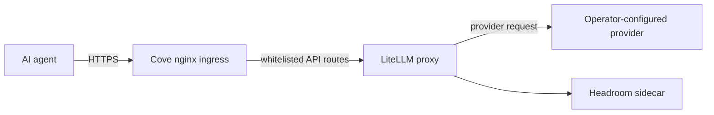

# LiteLLM Proxy for Cove

LiteLLM is an optional proxy for operator-configured language model deployments. Cove bundles generic proxy defaults and hardening. Model deployments, aliases, routing, load balancing, and fallback policy belong to each machine's persistent local config and are never included in Cove's repository or wheel.

## Quick Start

Resolve the same data root Cove uses (a shell `COVE_DATA_ROOT` takes precedence, then the value in the deployed Compose `.env`, then the default). Start the proxy once so Cove safely creates the private local directory and `local.env`:

```shell
cove litellm up

COMPOSE_ENV="${COVE_COMPOSE_DIR:-$HOME/.config/cove/compose}/.env"
if [[ -z "${COVE_DATA_ROOT:-}" && -f "$COMPOSE_ENV" ]]; then
  COVE_DATA_ROOT="$(sed -n 's/^COVE_DATA_ROOT=//p' "$COMPOSE_ENV" | tail -n 1)"
fi
COVE_DATA_ROOT="${COVE_DATA_ROOT:-$HOME/Documents/cove-data}"
${EDITOR:-vi} "$COVE_DATA_ROOT/litellm/local.env"

cove litellm up
cove litellm status
```

The first `cove litellm up` may start the proxy before providers are configured. The data root defaults to `~/Documents/cove-data`; Cove may use a different root from the shell or deployed Compose `.env`. `local.env` uses Docker env-file syntax (`NAME=value`). It is local runtime state, must remain private, and is not copied into YAML or committed to the repository. Cove passes this file to LiteLLM's container so the overlay can reference locally supplied provider variables. The `OLLAMA_API_KEY` Compose mapping is interpolated from the deployed Compose `.env` only: `cove up` strips ambient credential variables before Compose runs, so an exported shell value cannot override the file of record (a divergence is reported with fingerprints). Use the deployed `.env` (the workstation lane's SOPS projection) for this variable. Put other provider variables in `local.env`. If a variable is defined in both places, Compose's explicit `environment` mapping wins over `env_file`. Keep credentials in a secret store where available and materialize them through the operator's secret workflow.

**Converge contract:** a `cove up` that finds nothing to change is a no-op for LiteLLM. The container keeps its identity (no recreate, no restart) and the proxy never drops. Only a real change recreates it: a new bundled image or `LITELLM_IMAGE` pin, a changed `local.env` value, a changed `LITELLM_*`/`OLLAMA_API_KEY` Compose value, or a changed bind source. The live project converges from exactly one compose dir (`~/.config/cove/compose`); converging it from a second source would flip the absolute paths in its config hash and recreate LiteLLM for no reason, so `cove up` refuses that unless `COVE_ALLOW_NONCANONICAL_LIVE_SOURCE=1` is set deliberately.

LiteLLM is available through Cove's nginx ingress at `https://litellm.cove.local/`. The container binds to `127.0.0.1:4000`. Nginx allows up to 3600 seconds for upstream reads and sends, and disables response buffering so long-running streamed completions can reach clients as they arrive.

## Configuration ownership

| File | Owner | Purpose |
|---|---|---|
| Bundled `compose/litellm/config.base.yaml` | Cove | Generic proxy defaults and hardening; contains no model deployments, provider accounts, aliases, or routing policy. |
| `${COVE_DATA_ROOT}/litellm/config.local.yaml` | Operator | Persistent local model deployments, aliases, router settings, and other local customizations. |
| `${COVE_DATA_ROOT}/litellm/local.env` | Operator / secret workflow | Provider credentials and other environment values referenced by the local config. |
| `${COVE_DATA_ROOT}/litellm/config.yaml` | Generated by Cove | Merged runtime file consumed by LiteLLM. Do not edit it. |

Cove regenerates `config.yaml` during `cove up` and prepares the same runtime files before `cove litellm up`. This lets newer bundled defaults take effect without replacing the local overlay. The pinned LiteLLM 1.84.0 include loader is not used: its top-level list extension and replacement of other top-level keys do not implement Cove's nested precedence contract ([pinned loader source](https://github.com/BerriAI/litellm/blob/v1.84.0/litellm/proxy/proxy_server.py#L3323-L3355)).

## Merge precedence

Cove composes the base first and then applies the local overlay:

1. Mapping values merge recursively. A local scalar, mapping/list type change, or explicit `null` replaces the base value at that path.
2. `model_list` is the exception for lists: base entries are followed by local entries. Entries are never merged by index or name. Cove's base currently has no deployments, so all deployment entries remain machine-local.
3. Every other local list replaces the corresponding base list.
4. `general_settings.disable_mcp` and `general_settings.disable_jwt_auth` are sealed to `true`; startup rejects an overlay that changes or removes either setting.
5. Values under credential fields such as `api_key`, `master_key`, `password`, `secret`, and `token` must be `os.environ/NAME` references. Literal credential values are rejected.

LiteLLM 1.84.0's Router example uses repeated `model_name` entries as separate deployments and configures fallbacks between groups ([pinned source](https://github.com/BerriAI/litellm/blob/v1.84.0/litellm/router.py#L351-L380)). Put those deployment entries and `router_settings.fallbacks` only in the local overlay. Provider names, account names, model IDs, endpoint URLs, and the actual routing policy are deliberately not documented as repository examples; use the provider's LiteLLM parameter documentation to author the machine-local values.

For example, an overlay can refer to a secret without containing its value:

```yaml
litellm_settings:
  # Use the relevant provider parameter in your local deployment entry.
  drop_params: true
```

Use the appropriate `os.environ/VARIABLE_NAME` reference in the local deployment's credential field. Store `VARIABLE_NAME=value` in `local.env`. Do not put the value in YAML, shell history, or source control.

## Migration and reset

On the first bring-up after this feature, if `config.local.yaml` is absent and the existing `config.yaml` is present, Cove copies the existing file byte-for-byte to `config.local.yaml` before composing the runtime config. This preserves existing customizations. Cove then atomically replaces `config.yaml` with the merged result. Later bring-ups keep the local overlay and regenerate runtime config from the current bundled base.

If the legacy config contains literal credentials, migration preserves the file, but validation stops runtime generation and reports the credential field path without printing its value. Replace that value with an `os.environ/NAME` reference and put the secret in `local.env` (or provide it through the operator's secret workflow), then retry. The local overlay and env file are `0600`; the `litellm` host directory is `0700`. The generated runtime YAML is `0644` so container UID 1000 can read the bind mount. Config validation rejects literal values in credential-bearing fields before writing it; the private parent directory prevents other host users from traversing to the readable file.

The configured `COVE_DATA_ROOT` is the trusted root and may itself resolve through a symlink, which supports operator-managed mounted data volumes. Cove opens the `litellm` child relative to that root without following links, so an existing symlink at `${COVE_DATA_ROOT}/litellm` is rejected before setup can change its target. Isolated staging also compares canonical paths and rejects staging roots equal to, inside, or above the live data root.

To reset local LiteLLM config, edit or remove `config.local.yaml`, then run `cove litellm up` or `cove up`. Removing the overlay seeds an empty local mapping; it does not alter `local.env`. Never reset by deleting or editing the generated `config.yaml`.

## What's Hardened

| Layer | Mitigation |
|---|---|
| **Network** | Container binds to `127.0.0.1` only; nginx is the ingress boundary. |
| **Version** | Pinned to `litellm==1.84.0` with a multi-stage build. |
| **Routes** | Nginx allows only health and model API routes. |
| **Filesystem** | Container uses a read-only root filesystem with writable tmpfs for logs and DB. |
| **Credentials** | Credentials are injected through environment variables; YAML accepts environment references only for credential fields. |
| **Runtime files** | Local overlay and env file are `0600`; their real `litellm` child directory is `0700`. The configured data root may be a symlink, but Cove rejects a symlink at the child directory or env file. Generated merged YAML is `0644` for container UID 1000 and contains environment references for credential-bearing fields. |
| **MCP and JWT** | Disabled by Cove defaults and enforced during config composition. |

JWT auth is disabled by design because Cove is single-user and the service is reachable only through its local ingress boundary. Multi-tenancy is not supported.

## Commands

```shell
cove litellm up       # Prepare local config and start the proxy
cove litellm down     # Stop the proxy
cove litellm status   # Check health
cove litellm logs     # Tail logs
cove litellm logs -f  # Follow logs
cove litellm logs -n 100  # Show last 100 lines
```

## Architecture



## Troubleshooting

### Proxy won't start

```shell
cove litellm logs
```

Check that Docker is running, the proxy port is available, and every environment variable referenced by the local overlay is present in `local.env`. Check the YAML field path in validation errors; Cove does not print credential values. The runtime config is regenerated at startup, so make edits to `config.local.yaml`, not `config.yaml`.

### OpenCode can't connect

```shell
curl -H "Host: litellm.cove.local" https://127.0.0.1/health
curl -H "Host: litellm.cove.local" https://127.0.0.1/v1/models
```

If these succeed, configure the client to use `https://litellm.cove.local/v1` as its API base URL.

> **Clients do not hold the master key.** The master key is an
> edge/backend credential. Machine clients authenticate at
> `https://llmproxy.cove/v1` with the cove-owned edge client token
> (`op://Private/Cove LLM Proxy Client Key/client_key`), and nginx injects the
> master key server-side. See [bifrost.md](bifrost.md#client-endpoint-llmproxycove-product-neutral)
> for the credential table, the swap line, and the migration/rollback order.

### Admin routes accessible

If `/key/generate` or other admin routes are reachable, inspect the generated nginx config's LiteLLM server block and confirm its route whitelist is intact.

## Upgrade Procedure

1. Wait 48–72 hours after a LiteLLM release before upgrading, allowing time for supply-chain issues to surface.
2. Review the [LiteLLM release notes](https://github.com/BerriAI/litellm/releases) and [security advisories](https://github.com/BerriAI/litellm/security/advisories).
3. Update the version pin in `compose/litellm/Dockerfile`.
4. Rebuild and restart the proxy through Cove's service workflow.
5. Verify the health and model API routes.
